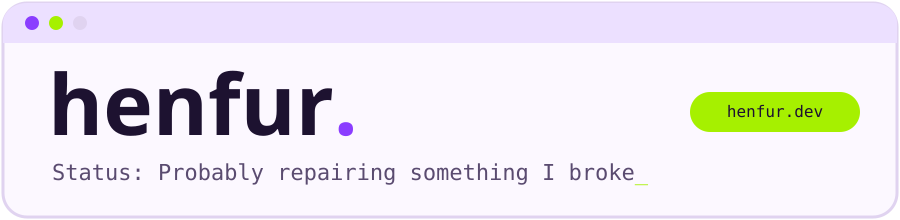

<a href="https://henfur.dev">
<picture>
  <source media="(prefers-color-scheme: dark)" srcset="assets/banner-dark.svg">
  
</picture>
</a>

<picture>
  <source media="(prefers-color-scheme: dark)" srcset="assets/divider-dark.svg">
  
</picture>

## About

Hi, I'm henfur. I'm a SecOps engineer. I mostly built stuff related to security and infrastructure management.